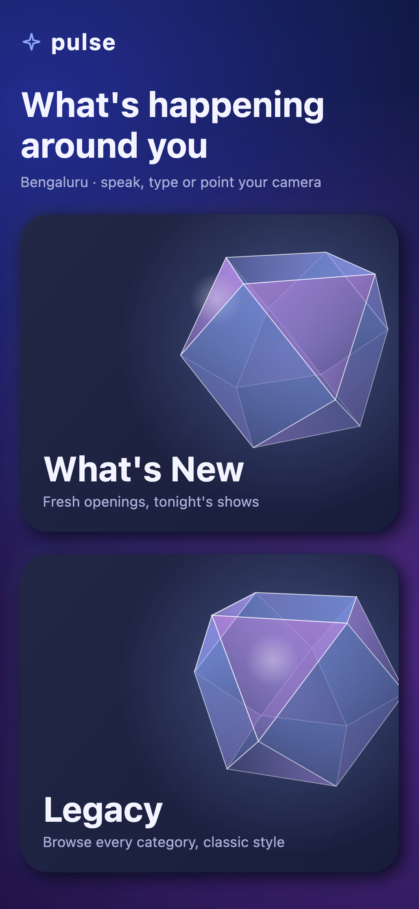
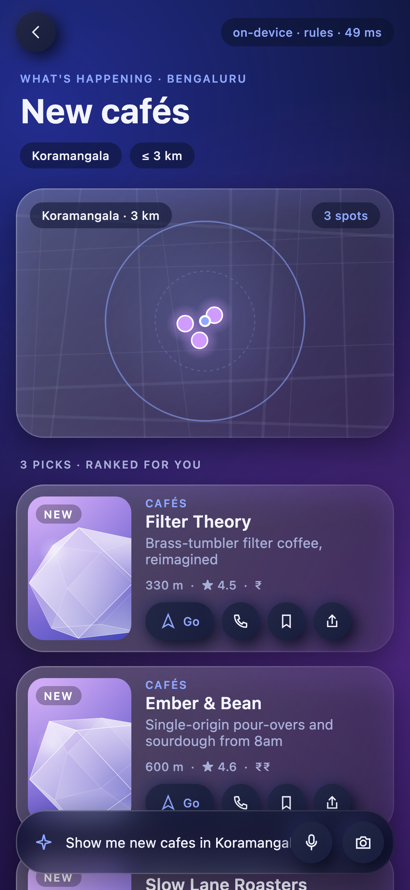
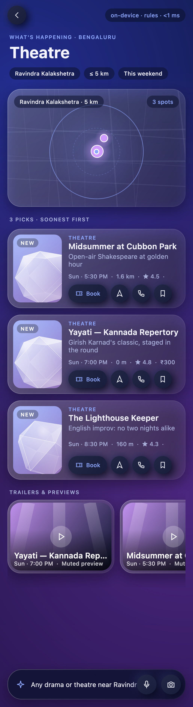
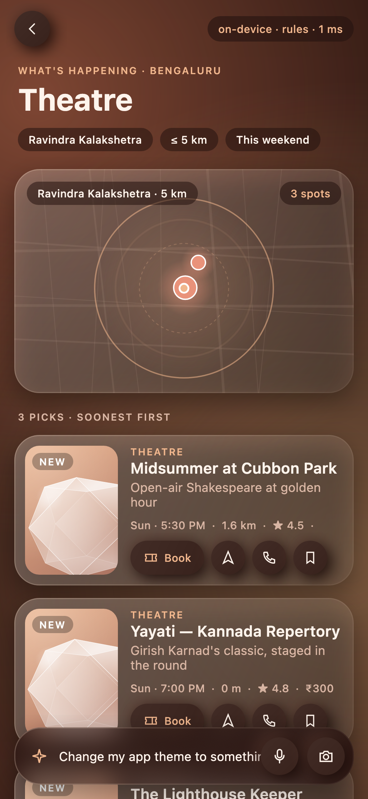

# Pulse

An AI-first, intent-driven discovery app for "what's happening around me". Kotlin Multiplatform
(Android + iOS), Compose Multiplatform, on-device AI, Spring Boot microservices and a Python AI server.

Every screen after the landing page is **generated from user intent**: utterance → on-device
`IntentFrame` → `SurfaceComposer` → validated `UiPatch` → Compose renderer + component registry.
There are no chat bubbles. It works offline.

| Landing | "New cafés in Koramangala ≤3 km" | "Theatre this weekend" | "Warm and quieter" |
|---|---|---|---|
|  |  |  |  |

Start with **[docs/](docs/README.md)**.

## Quick start

Requires JDK 21 (Gradle downloads JDK 17 for the KMP modules automatically).

```bash
./gradlew -p packages :ui-dsl:jvmTest                                  # DSL: composer, reducer, validator, golden examples
./gradlew -p services test                                             # all Spring services (Testcontainers ITs need Docker)
./gradlew -p apps/mobile :shared:core:desktopTest -Ppulse.android=false   # on-device AI + pipeline
./gradlew -p apps/mobile :desktopApp:run -Ppulse.android=false            # the app in a phone-sized window
./gradlew -p apps/mobile :desktopApp:screenshots -Ppulse.android=false    # headless renders → docs/screenshots
(cd ai-server && python3 -m venv .venv && .venv/bin/pip install -e '.[dev]' && .venv/bin/pytest -q)
docker compose -f infra/local/docker-compose.yml up -d                 # PostGIS, Kafka API, Redis, OTel
```

Android: with the Android SDK installed (`local.properties` → `sdk.dir`), `./gradlew -p apps/mobile :androidApp:assembleRelease`.
The signed, R8-shrunk, arm64 APK lands in `apps/mobile/androidApp/build/outputs/apk/release/` (about 30 MB).
Release signing reads the gitignored `apps/mobile/androidApp/keystore.properties`; without it the build falls back to the debug key.
iOS: `brew install xcodegen && cd apps/mobile/iosApp && xcodegen && open iosApp.xcodeproj` (needs Xcode).

## Status

| Area | State |
|---|---|
| UI DSL (`packages/ui-dsl`) | Done, 31 tests |
| Mobile core: AI ladder, rules parser, pipeline, resolver, ranker, privacy, OTA | Done, 37 tests (desktop JVM); compiles for iOS |
| Mobile UI: design system, registry, renderer, 5 reference components, screens | Done, rendered headlessly |
| catalog-service (hexagonal, PostGIS, outbox → Kafka, OpenAPI) | Done, 31 tests + 2 Docker ITs |
| 7 other services | Skeletons: domain cores, 12 tests + 8 planned IT placeholders |
| AI server: frames, re-rank, eval gate, distillation plan | Done, 6 tests |
| Android app | **Built and smoke-tested** on a Pixel 7 emulator (API 35): launch, What's New, typed intents |
| iOS app | Shared code compiles for iOS; app not built yet (needs Xcode) |
| Gemini Nano rung, MapLibre tiles, inline video, camera vision | Integration points, P1-P3 |
