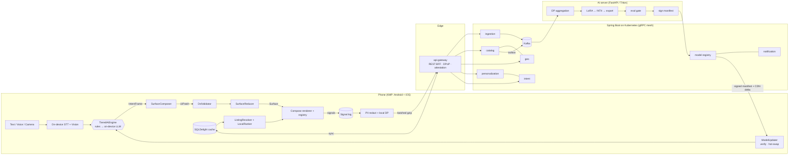

# Pulse: executive summary

Pulse is an AI-first discovery app for "what's happening around me". It launches in Bengaluru and is
global-ready by design. **No screen after the landing page is hardcoded.** The user speaks, types or
points a camera, and an on-device pipeline turns that request into a *UI Intent DSL* patch that a
Compose Multiplatform renderer paints from a component registry.

The core architectural bet is to **split "what the user wants" from "how it is painted"**:

1. **Understand.** A tiered on-device engine emits a compact `IntentFrame` (30-60 tokens). The
   deterministic rules rung answers in under 5 ms, and an on-device LLM (Gemini Nano / Apple Foundation
   Models / Gemma 3 1B INT4) refines only when the rules are unsure and the device isn't hot.
2. **Compose.** A pure `SurfaceComposer` expands the frame into a `UiPatch` using the user's saved
   layout and theme. It runs identically on phone and server.
3. **Validate and reduce.** Every patch passes the same validator and an atomic reducer, so bad
   model output can never break a screen.
4. **Resolve data locally.** The model never produces content. Listings come from the offline cache
   and are ranked on-device by a personal ranker. The server is an enhancer, not a dependency.

The backend is Kotlin/Spring Boot 3.5 hexagonal microservices (gRPC inside, REST BFF at the edge,
Kafka between ingestion and AI), PostgreSQL + PostGIS + pgvector, Redis and S3. A Python AI server
aggregates differential-privacy signals, re-ranks, and runs the distillation pipeline: LoRA, then
INT4, then MediaPipe / GGUF / Core ML exports, then the eval gate, then signed OTA manifests.

**Built so far:** the DSL, composer, reducer and validator (31 tests); on-device AI core, intent
pipeline, ranking, privacy and model updates (37 tests); the full Compose UI with 5 reference
components; catalog-service end to end (31 tests + 2 Testcontainers ITs); 7 service skeletons
(12 domain tests + 8 planned integration-test placeholders); and the AI server (6 tests). See the [screenshots](screenshots/).

