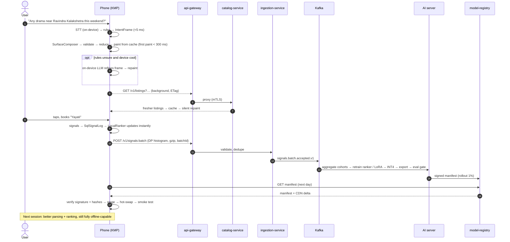

# Mobile ↔ server contract

Plain-language version first, details after each.

## 1. Authentication: anonymous-first, upgrade later

**In short:** the app works the moment it's installed. It proves it is a genuine, untampered Pulse app
(not a script) and gets a short-lived pass. Signing in later just attaches a name to that history.

1. On first launch the app creates a key pair in hardware (Android Keystore / iOS Secure Enclave).
   The private key never leaves the chip.
2. It asks the OS for an integrity verdict (**Play Integrity** / **App Attest**) bound to a server nonce.
3. `POST /v1/auth/anonymous` sends the public key and verdict. The gateway verifies with Google/Apple
   and issues a **15-minute access token bound to the device key (DPoP, RFC 9449)**, plus a refresh token.
   A stolen token is useless without the key.
4. Optional sign-in (Google, Apple, phone OTP via OIDC) *links* the anonymous principal, so
   history, saves and personalization carry over.

## 2. Transport: REST BFF (recommended over GraphQL)

**In short:** the phone already describes what it needs in a structured way (the DSL's
`ListingQuery`), so it sends that to one well-cached endpoint instead of learning a second query language.

- `GET /v1/listings?lat&lng&radius&category&...`: proxied to catalog-service; responses carry
  `ETag` and are CDN-cacheable by geohash-6 bucket.
- `POST /v1/surface:resolve`: a batch of `Binding`s in, listings per binding out (one round trip per surface).
- Payloads are JSON with gzip, over HTTP/2 + TLS 1.3 with certificate pinning to the gateway.
- Everything is written into the SQLDelight cache first, and **the UI always renders from the cache**.
  The network only makes the cache fresher.

## 3. Signals: batched, compressed, encrypted, retried

**In short:** taps and likes stay on the phone. Occasionally the phone sends a blurred summary
("about this much interest in arts this week") that can't identify you, and retries until it lands
exactly once.

| Step | Where | Detail |
|---|---|---|
| Capture | `IntentPipeline.record` → `SqlSignalLog` | tap, dwell, save, like, attend, refine, dismiss |
| Redact | `PiiRedactor` | phones, emails, card and ID numbers stripped from any free text |
| Aggregate | `LocalDifferentialPrivacy.histogramOf` | **root categories only** (`arts`, `food`), never listing IDs |
| Privatize | Laplace noise, ε = 2, per-category clip | each upload is individually deniable |
| Batch | `SignalUploader` | ≤500 signals/batch; WorkManager / BGTaskScheduler on unmetered + charging |
| Compress, encrypt | Ktor `ContentEncoding(gzip)`, TLS 1.3 | |
| Retry | exponential backoff 1 s → 60 s; 4xx (except 429) is final | `batchId` is an idempotency key, so retries never double count |
| Server checks | `ingestion-service.AcceptBatch` | rejects ε > 4, fine-grained keys, bad windows; dedupes in Redis |

## 4. Model updates: pull, verify, hot-swap

**In short:** new AI models arrive like app updates, but smaller and safer. The phone refuses
anything not signed by Pulse's offline key, checks every byte, and switches over between requests.
If the new model misbehaves, it switches back.

1. `GET /v1/models/{channel}/manifest` (daily, or pushed via silent notification).
2. `ModelUpdater.apply`: **verify Ed25519 signature** over `canonicalPayload()` (the public key is
   compiled into the app) → check `minAppVersion` → check staged-rollout bucket.
3. Download (prefer **bsdiff delta**, 5-15% of full size) → verify **SHA-256** per artifact.
4. Stage, then **atomic rename** to active (the previous version is kept).
5. The engine reloads the backend *between* requests (hot-swap, no restart), then runs a smoke test.
   On failure: **rollback**, plus telemetry that halts the rollout server-side.

## 5. Full round trip

